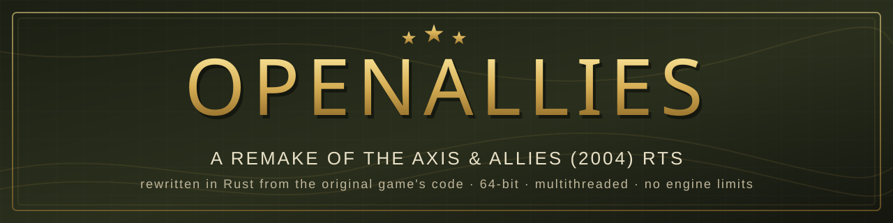
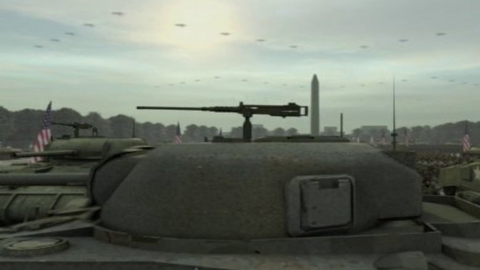
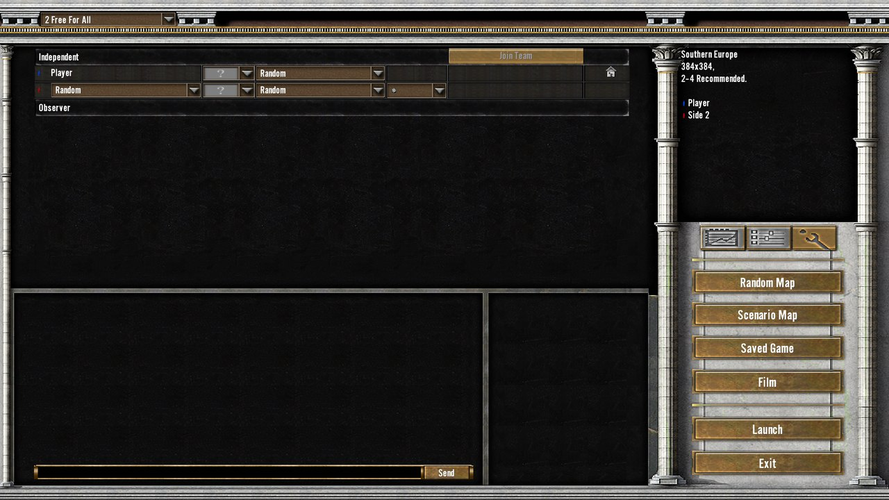
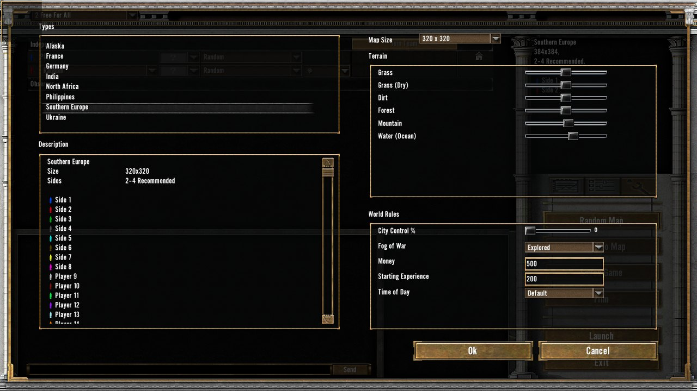
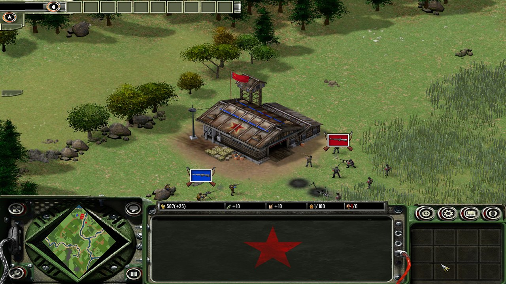
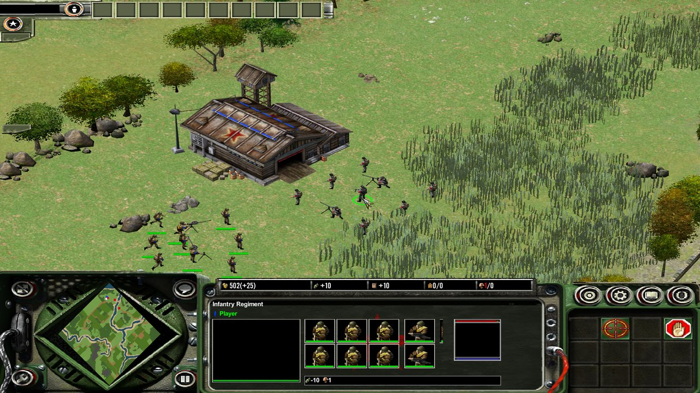
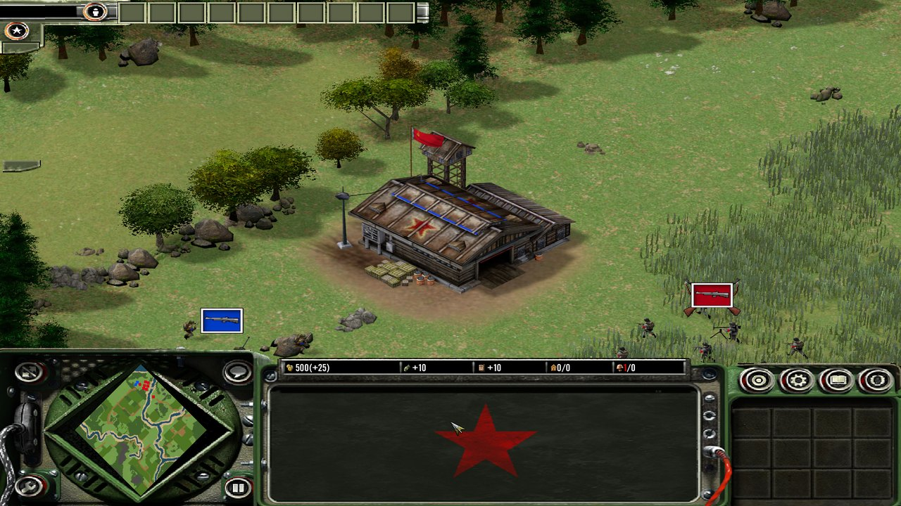

<p align="center">
  
</p>

<p align="center">
  
  
  
  
  <a href="LICENSE"></a>
  
</p>

**OpenAllies** recreates **Axis & Allies (2004)**, the real-time strategy game by TimeGate Studios, in Rust with the [Bevy](https://bevyengine.org/) engine.

The goal is a game so close to the original that a player can barely tell the difference. Every system follows the original game's own code (`AA.exe`) and every number comes from the original rules data. Menus, HUD, maps, models, animations and texts are read from the **original game files on your own installed copy**. No art, sound, video, maps or game data from the original are included in this repository.

> [!IMPORTANT]
> OpenAllies is a **work in progress**. You can play custom battles against the computer, try the campaign missions and the World War II strategic game, watch films recorded by the original game, and record your own. Multiplayer, the editor and saved battles are still missing, and most recorded games do not yet replay exactly as they happened. See [Project status](#project-status) and [Matching the original](#matching-the-original).

## Screenshots

| | |
|:---:|:---:|
|  |  |
| The original main menu, drawn from the game's own layout files | The original Custom game setup screen |
|  |  |
| The random map generator with the original options | Infantry fighting at a Russian Corps HQ: banners, flag, ground patch |
|  |  |
| A selected regiment with the original HUD and unit panel | Floating regiment banners, own and enemy |

---

## Contents

- [Goals](#goals)
- [How it is built](#how-it-is-built)
- [Project status](#project-status)
- [Matching the original](#matching-the-original)
- [Architecture](#architecture)
- [Building and running](#building-and-running)
- [Repository layout](#repository-layout)
- [Contributing](#contributing)
- [License](#license)
- [Legal](#legal)

## Goals

| | |
|---|---|
| **Faithful** | The same rules, numbers and behaviour as the original: combat, movement, AI, economy, maps and the interface work as `AA.exe` does. |
| **Original assets** | Art, audio, video, maps and rules data are read from your installed game. |
| **Every platform** | The finished game is planned for **Windows (x64 and ARM64), macOS (Apple Silicon and Intel) and Linux**. Bevy and the rest of the code are cross-platform; today's test builds are Windows x64 only. |
| **64-bit and fast** | No 32-bit address-space ceiling; a full battle simulation tick costs well under a millisecond. |
| **No engine limits** | Fixed-size engine arrays, pools and caps become growable. Gameplay rules, like configured unit caps, keep their original defaults. |
| **Byte for byte** | The target is a game that matches the original exactly. Systems move onto exact ports of the original code one by one, staying playable throughout, and recorded games of the original prove how far each has come. |

## How it is built

Each system is written from the original game's code and data:

- **Read the original.** The game's functions are studied from its code and translated exactly into the `aa-*` crates of this workspace, each proven against the original code running in the [Unicorn](https://www.unicorn-engine.org/) emulator.
- **Run on the ports.** The playable game (`aa-play`) moves onto those exact ports system by system, and is playable at every step. Every number comes from the original rules files; nothing the original does not have is added. Original addresses are cited in the code.
- **Use the original look.** The original menus and HUD are built from the original layout files by the ported UI engine (`aa-ui`) and drawn in Bevy. Models, animations, terrain transitions and textures are the original files.
- **Compare with the original.** Behaviour is checked against the running original game: screenshots, unit speeds, damage, recruit times, AI timelines. The strictest test is a recorded film of the original: its checkpoints show exactly where the two games first differ.

The rules for the exact ports are in [`docs/NATIVE-PORT-RULES.md`](docs/NATIVE-PORT-RULES.md).

## Project status

Legend: ✅ working, 🚧 in progress, ⏳ not started.

| Area | Status | Notes |
|---|:---:|---|
| Original menus, setup screen, loading screen | ✅ | Main menu with the original video, Single Player, the Custom staging screen, Random Map and scenario dialogs |
| Random map generator | ✅ | Exact on the standard data: all 12 maps compared equal the original's world. Mods with their own random map folder are not exact yet |
| Original maps | ✅ | All 80 original maps load |
| In-game HUD | ✅ | Economy bar, unit panel, action buttons, minimap, message log, game menu, tooltips. Selecting several units shows only the first in the unit panel |
| Camera, selection, orders | ✅ | The original camera; click, box and double-click selection; right-click move and attack; guard, retreat, explore and group orders. Right-drag to set a move's facing is not built |
| Economy, recruiting, research, supply | ✅ | Income and upkeep, recruit queues, truck deployment, supply zones, city capture |
| Fog of war | ✅ | The original's zones on every building, regiment and city, on the map and the minimap |
| Movement and pathfinding | 🚧 | Units and regiments run on exact ports: the ground step, the unit and regiment Minds, the original route solver. Collisions and some regiment orders are still being matched |
| Combat and morale | 🚧 | The original damage rules, projectiles, zones of control, morale, routing, entrenchment and experience. Results are close to the original's, not yet the same |
| Computer opponent | 🚧 | The original AI generals, goal engine and recruit planner. It does not yet give every order the original's AI gives, and its early army is a little smaller |
| Unit banners and selection marks | ✅ | The original banner model and decals, health bars |
| Rendering | ✅ | Bevy: original models, animations, terrain transitions, the original's lighting and shadows. The ground's detail textures are still missing |
| Effects | 🚧 | Building ground patches, waving flags and many weapon effects |
| Sound and music | 🚧 | Sounds in battle; menus are still silent |
| Films: watching | 🚧 | The full film screens: list, viewing any side, speed, end of film, scoring and replay. Most films drift from what really happened partway through: see [Matching the original](#matching-the-original) |
| Films: recording | ✅ | Battles record films in the original's format, and the original game can open them |
| Campaign missions | 🚧 | Mission list, saved progress, scripts, scripted cameras, movies, debriefing. Not all missions have been played through |
| World War II | 🚧 | The strategic map, buying armies, fighting battles and returning to the map, saves. Some displays and tooltips are not built |
| Multiplayer | 🚧 | The LAN session layer exists and has been tested only against itself; it cannot be reached from the game yet |
| Saved games | 🚧 | Saved worlds load well enough to start films of saved games, partly. Saving and loading a battle is not built |
| Editor | ⏳ | |
| Windows ARM64, macOS, Linux | ⏳ | Planned for the finished game; today Windows x64 only |

Each system lists the behaviours still to be compared with the original game; dated progress notes live in [`HANDOFF.txt`](HANDOFF.txt) and [`docs/`](docs/).

## Matching the original

The original game records every battle as a film: only the players' orders, plus a checkpoint of its random number stream every 17 game ticks. A film plays back correctly only if the game produces exactly the same results from those orders. So replaying the original's films is the hardest test there is: a checkpoint matches only if every earlier random draw happened in the same order.

Where this stands on 2 November 2026 (Development 22):

| Test | Result |
|---|---|
| A 2-against-2 Berlin film, matching checkpoints in order | **93 of 266**, about a third of the film, up from 32 at the start of November. This film has almost no fighting |
| Real recorded films that open | **52 of 62**. The other 10 refuse with the original's own messages (9 made by another version of the game, 1 never finished) |
| Real films with no mismatch | **5**, all random-map films, most of them short: 4 to their natural end and 1 over its first 4,000 ticks. 3 of them are on modded data. Other short random-map films still drift early |
| Films recorded by OpenAllies, replayed in OpenAllies | **Every checkpoint**: 204 of 204 and 240 of 240 in the runs checked, with real fighting |
| Random map generator | **12 of 12** maps compared equal the original's world: every object, both height layers, tiles and the final random state |
| Films we record, opened in the original | The original opens them and stays in sync for 28 checkpoints on Berlin and 24 on a random map, until the computer's orders differ |
| Fighting, 4 films with real battles: units reaching zero health, ours against the original | 23 / 27, 126 / 107, 86 / 119, 116 / 133. Close in size, not yet the same battles, because the games have already drifted apart before the fighting starts |

Next: the remaining movement differences, which decide most of the Berlin film, then the computer's orders and exact fights. Details and the ordered list of causes are in [`research/byte-exact/PARITY-CENSUS.md`](research/byte-exact/PARITY-CENSUS.md) and [`research/byte-exact/FILM-PLAYBACK.md`](research/byte-exact/FILM-PLAYBACK.md).

## Architecture

A Cargo workspace of focused crates, roughly bottom to top:

| Crate | Purpose |
|---|---|
| `aa-formats`, `aa-assets`, `aa-resources` | Readers for the original archives and formats (including the Gamebryo NIF reader); asset access |
| `aa-rules` | The original TGI rules language and the native data-loading order |
| `aa-mapworld` | Original map loading |
| `aa-play` | **The playable battle:** game data, maps, custom setup, economy, recruiting, supply, movement, combat, morale, the computer opponent, the random map generator |
| `aa-bevy` | **The game application** on Bevy 0.19: menus and HUD, camera, selection and orders, battle drawing, effects. It is its own Cargo workspace (see below) |
| `aa-ui` | Port of the original UI engine, driven by the original layout files |
| `aa-animation` | Original model animation playback |
| `aa-numeric`, `aa-trig` | Exact x87 arithmetic and the original's trigonometry (for the exact ports) |
| `aa-world`, `aa-simulation`, `aa-runtime` | The exact-port world: native update queues, scheduling, the authoritative world |
| `aa-actors`, `aa-body`, `aa-combat`, `aa-movement`, `aa-navigation`, `aa-spatial`, `aa-heightfield`, `aa-zones`, `aa-mind`, `aa-economy`, `aa-production`, `aa-triggers` | Exact ports of the original systems, the reference for `aa-play` |
| `aa-orders`, `aa-transfer`, `aa-netcode` | Player commands and the multiplayer protocol |
| `aa-metagame` | The World War II strategic mode |
| `aa-parity` | Films: reading, playing and recording them, and comparing a replay with the original |
| `aa-client` | The earlier wgpu client and asset viewer |

## Building and running

**Requirements**

- Today: Windows 10 or 11, x64, with a Vulkan or DirectX 12 graphics driver. Windows on ARM, macOS and Linux are planned for the finished game
- A recent stable [Rust](https://rustup.rs/) toolchain (Rust 2024 edition, `rust-version = "1.88"`)
- Your own installed copy of **Axis & Allies (2004)**

```bash
git clone https://github.com/haskbasirat/OpenAllies.git
cd OpenAllies
cargo build --release --manifest-path crates/aa-bevy/Cargo.toml
```

`aa-bevy` is a separate Cargo workspace on purpose: Bevy's shader tooling enables a feature of a shared dependency that breaks the older wgpu client when both are built together. The rest of the workspace builds with `cargo build --release`.

> [!NOTE]
> The game reads the original data from your installed game and from a local folder prepared from it (the extracted original assets and converted models and textures). None of that data is in this repository, and a single setup tool that prepares it from a game installation is still to come. Until then, running from a fresh clone needs that local preparation first.

Run the game logic tests (the real-data tests need `AA_GAME_ROOT` pointing at your installed game):

```bash
cargo test -p aa-play --release
```

## Repository layout

```text
crates/      the Rust workspace
docs/        design notes, porting rules, progress records, screenshots
research/    oracle scripts (Python + Unicorn), notes and per-area findings
HANDOFF.txt  running continuation log for developers
```

## Contributing

1. Find the original behaviour in the game's code and data, and cite the native addresses.
2. Follow the original's steps, rules and order; take every number from the original data.
3. Never add features or interface elements the original does not have.
4. List what still has to be compared with the running original.
5. Never commit files taken from the original game.

## License

OpenAllies is free software: you can redistribute it and/or modify it under the terms of the **GNU General Public License**, version 3 or (at your option) any later version. See [`LICENSE`](LICENSE) for the full text.

The license covers the OpenAllies source code only. It does not cover the original game, whose files you need from your own copy.

## Legal

OpenAllies is an independent, non-commercial fan project. It is **not affiliated with, endorsed by or sponsored by** Hasbro, Wizards of the Coast, Avalon Hill, Atari or TimeGate Studios. *Axis & Allies* is a trademark of its respective owner. The original game was developed by TimeGate Studios and published by Atari in 2004.

This repository contains **no original game files**: no art, audio, video, maps, rules data, executables or recordings of the original program's behaviour. The screenshots show OpenAllies running with the original game's assets from a legally owned copy. To use OpenAllies you need your own legally obtained copy of the original game.
