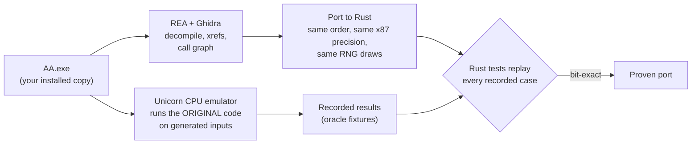

<p align="center">
  
</p>

<p align="center">
  
  
  
  
  
</p>

**OpenAllies** is a remake of **Axis & Allies (2004)**, the real-time strategy game by TimeGate Studios, rewritten in Rust.

It is not a lookalike built from scratch. Every gameplay rule is ported from the original game's own code (`AA.exe`), and each port is checked against the original code running in a CPU emulator. The new engine is **64-bit**, uses **multiple threads** where that can't change results, and drops the original's fixed engine limits (memory pools, buffer and bandwidth caps, unit and slot masks).

OpenAllies uses the **original game's assets from your own installed copy**. No art, sound, video, maps or game data from the original are included in this repository.

> [!IMPORTANT]
> OpenAllies is **pre-alpha and not playable yet**. Large parts of the original game are ported and verified piece by piece. Assembling them into a running battle is the work in progress now. See [Project status](#project-status).

---

## Contents

- [Goals](#goals)
- [How the port works](#how-the-port-works)
- [Project status](#project-status)
- [Architecture](#architecture)
- [Building](#building)
- [Repository layout](#repository-layout)
- [Contributing](#contributing)
- [Legal](#legal)

## Goals

| | |
|---|---|
| **Faithful** | Same rules, same numbers, same quirks as the original: combat, movement, AI, economy, missions and multiplayer behave as `AA.exe` does. |
| **64-bit** | No 32-bit address-space ceiling. |
| **Multithreaded** | Rendering, asset streaming, audio, the computer opponent's strategic AI and read-only queries (pathfinding, zone and visibility queries) run in parallel. The simulation itself keeps the original update order and random-number stream, so results and multiplayer sync stay identical. |
| **No engine limits** | Fixed-size engine arrays, pools and caps become growable. Gameplay *rules*, like configured unit caps, keep their original defaults. Wire- and save-format values stay compatible with the original. |
| **Original assets** | Art, audio, video, maps and rules data are read from your installed game. |

## How the port works

Each behaviour of the original game is traced to the machine code that implements it, translated to Rust, and then proven against the original code.



- **Locate.** Strings, rule-file keys and the call graph lead from a feature to the native functions behind it. Addresses are cited in the Rust doc comments.
- **Port.** Same evaluation order, same 32-bit float stores, same random-number consumption, same error paths. Nothing is invented: if a behaviour can't be proven yet, the code returns an explicit "unsupported" error instead of guessing.
- **Prove.** The original x86 code runs under the [Unicorn](https://www.unicorn-engine.org/) emulator on thousands of generated inputs, at the x87 precisions the game uses. The Rust tests must reproduce every recorded result bit for bit. Those recordings are regenerated locally from your own copy of `AA.exe` and are not distributed.

The full rules for contributors are in [`docs/NATIVE-PORT-RULES.md`](docs/NATIVE-PORT-RULES.md).

## Project status

Legend: ✅ ported and verified against the original, 🚧 in progress, ⏳ not started.

| Area | Status | Notes |
|---|:---:|---|
| Game loop, timing, update scheduling | ✅ | Frame/tick driver, fixed 1/16 s step, original update order |
| Economy, production, research, construction | ✅ | Kingdom economy tick, recruitment, research, building, supply |
| Combat | ✅ | Damage, death, morale, experience, capture, generals' special operations |
| Movement and pathfinding | ✅ | Unit movement, formations, collision, region and local pathfinding, aircraft |
| Zones, detection, fog of war | ✅ | Zones of control and supply, who sees whom, shared vision |
| Unit AI and computer opponent | 🚧 | Unit behaviours and much of the strategic AI ported; goal planning in progress |
| Mission triggers | ✅ | Every trigger type the 26 campaign and tutorial missions use |
| Player commands | ✅ | All 357 original command types: wire format and request/decree flow |
| Multiplayer session layer | 🚧 | Protocol ported, tested over loopback only; no two-machine tests yet |
| Map and saved-world loading | 🚧 | Most object types load as the original does; world start and publication in progress |
| User interface | 🚧 | Ported UI engine builds menus, options, credits, loading screen and HUD from the original layout files |
| World War II strategic mode | 🚧 | Turns, orders, battles, saves and its AI largely ported |
| Rendering of the live game world | 🚧 | Original models, terrain, water and animations render; not yet driven by the ported simulation |
| Playable skirmish battle | 🚧 | The current integration goal |
| Campaign, editor, film/replays | ⏳ | After skirmish and multiplayer |

Detailed, dated progress notes live in [`HANDOFF.txt`](HANDOFF.txt) and [`docs/`](docs/).

## Architecture

A Cargo workspace of focused crates, roughly bottom to top:

| Crate | Purpose |
|---|---|
| `aa-numeric`, `aa-trig` | Exact x87 arithmetic at explicit precision; the original's quantized trigonometry; the C runtime's `pow` |
| `aa-formats`, `aa-assets`, `aa-resources` | Readers for the original archives and formats; asset access and load planning |
| `aa-rules` | The original TGI rules language and the native data-loading order |
| `aa-world`, `aa-simulation`, `aa-runtime` | Native update queues, deterministic scheduling, and the authoritative world that ties the systems together |
| `aa-actors`, `aa-body` | Actors, components, creation, saved-state loading; health, damage and properties |
| `aa-combat` | Weapons, projectiles, morale, capture, generals' special operations |
| `aa-movement`, `aa-navigation`, `aa-spatial`, `aa-heightfield` | Movement, formations, pathfinding, collision and terrain queries |
| `aa-zones` | Zones, detection and fog of war |
| `aa-mind` | Unit AI and the computer opponent's strategic AI |
| `aa-economy`, `aa-production` | Economy, recruitment, research and construction |
| `aa-triggers` | Mission scripts |
| `aa-orders`, `aa-transfer`, `aa-netcode` | Player commands and the multiplayer protocol |
| `aa-mapworld` | Original map and saved-world loading |
| `aa-metagame` | The World War II strategic mode |
| `aa-ui` | Port of the original UI engine, driven by the original layout files |
| `aa-animation` | Original model animation playback |
| `aa-client` | The application: wgpu renderer, menus, viewer and live scene |

## Building

**Requirements**

- Windows 10 or 11, 64-bit
- A recent stable [Rust](https://rustup.rs/) toolchain (Rust 2024 edition; the workspace declares `rust-version = "1.88"`)
- Your own installed copy of **Axis & Allies (2004)**

```bash
git clone https://github.com/haskbasirat/OpenAllies.git
cd OpenAllies
cargo build --release -p aa-client
```

> [!NOTE]
> Today the build and tests expect a local data folder prepared from your installed game: the extracted original assets, plus the research recordings that the oracle scripts in [`research/`](research/) produce from your own `AA.exe`. None of that data is in this repository, and a single setup tool that prepares it from a game installation is still to come. Until then, building from a fresh clone needs that local preparation first.

Run the tests for one area, for example combat:

```bash
cargo test -p aa-combat --release
```

## Repository layout

```text
crates/      the Rust workspace (29 crates)
docs/        design notes, porting rules, dated progress and validation records
research/    oracle scripts (Python + Unicorn), notes and per-area findings
HANDOFF.txt  running continuation log for developers
```

## Contributing

Read [`docs/NATIVE-PORT-RULES.md`](docs/NATIVE-PORT-RULES.md) first. In short:

1. Find the native function behind a behaviour and cite its address.
2. Port it with the same order, precision, random draws and failure behaviour.
3. Prove it: record the original code's results under the emulator and add Rust tests that replay them.
4. Never invent defaults or turn a missing piece into silent success. Return an explicit error instead.
5. Never commit files taken from the original game.

## Legal

OpenAllies is an independent, non-commercial fan project. It is **not affiliated with, endorsed by or sponsored by** Hasbro, Wizards of the Coast, Avalon Hill, Atari or TimeGate Studios. *Axis & Allies* is a trademark of its respective owner. The original game was developed by TimeGate Studios and published by Atari in 2004.

This repository contains **no original game files**: no art, audio, video, maps, rules data, executables or recordings of the original program's behaviour. To use OpenAllies you need your own legally obtained copy of the original game.

No open-source license has been chosen for this code yet. Until one is added, all rights are reserved by the authors.
