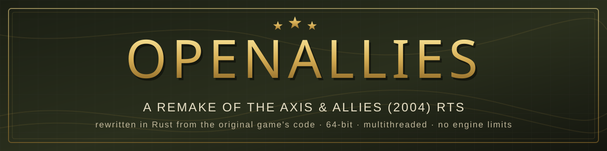
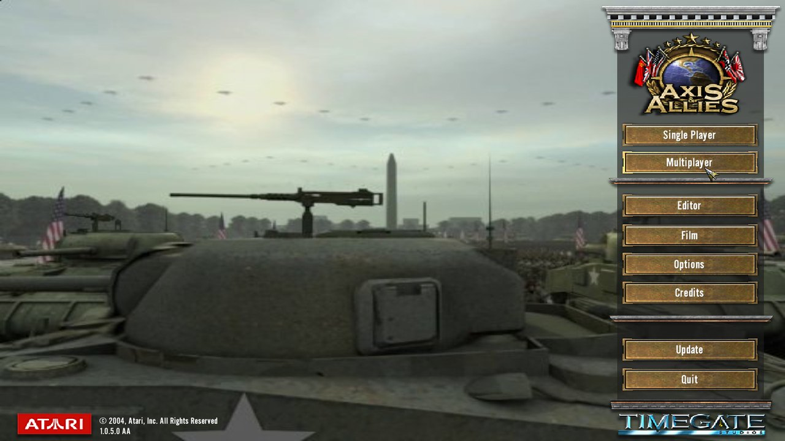
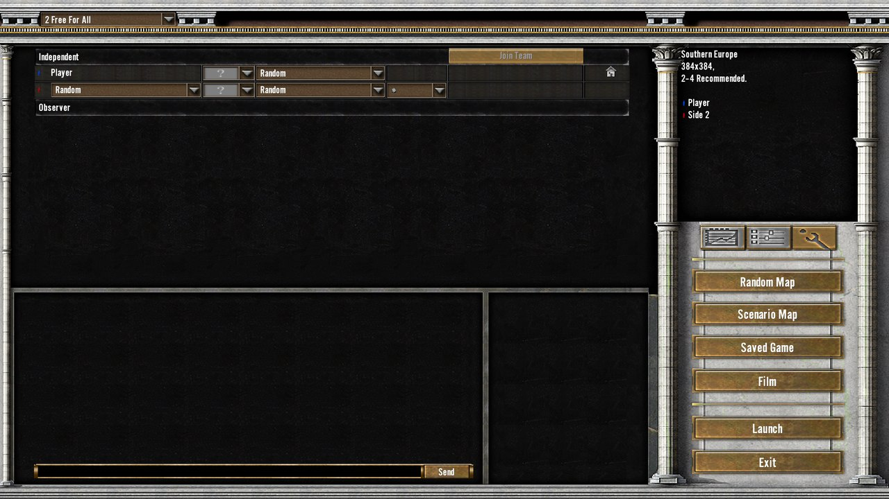
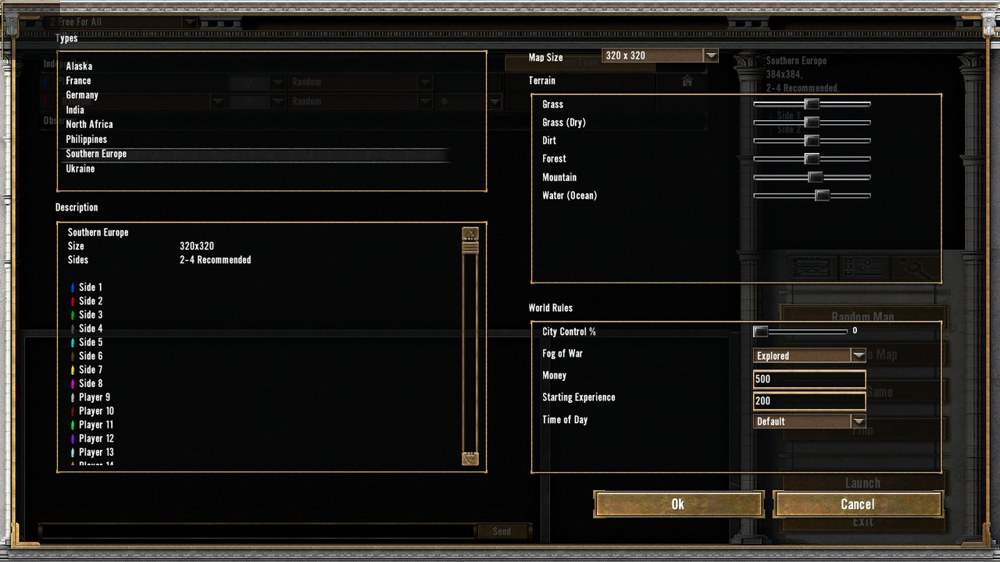
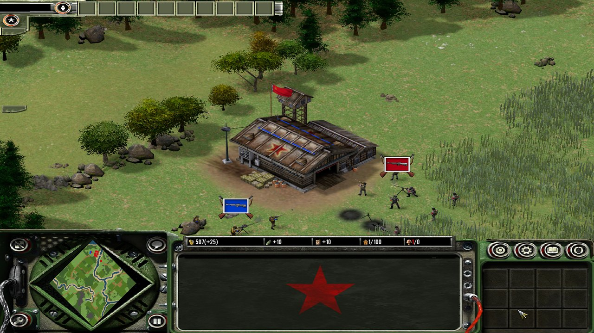
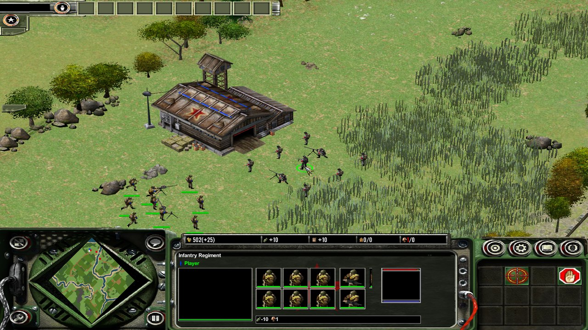
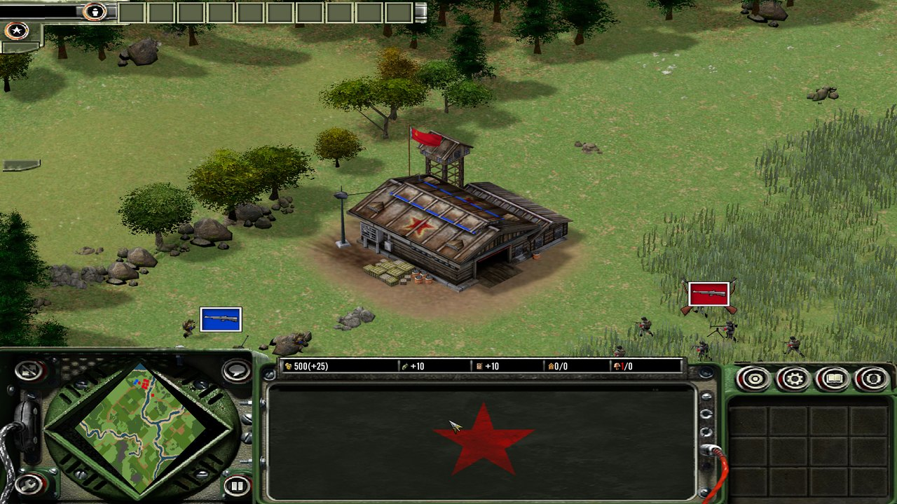

<p align="center">
  
</p>

<p align="center">
  
  
  
  
  
</p>

**OpenAllies** recreates **Axis & Allies (2004)**, the real-time strategy game by TimeGate Studios, in Rust with the [Bevy](https://bevyengine.org/) engine.

The goal is a game so close to the original that a player can barely tell the difference. Every system follows the original game's own code (`AA.exe`) and every number comes from the original rules data. Menus, HUD, maps, models, animations and texts are read from the **original game files on your own installed copy**. No art, sound, video, maps or game data from the original are included in this repository.

> [!IMPORTANT]
> OpenAllies is a **work in progress**. You can play a custom battle against the computer: the original menus and setup screen, original and random maps, recruiting, movement, combat and the computer opponent all work. Sound, many effects, campaigns, multiplayer and the editor are still missing. See [Project status](#project-status).

## Screenshots

| | |
|:---:|:---:|
|  |  |
| The original main menu, drawn from the game's own layout files | The original Custom game setup screen |
|  |  |
| The random map generator with the original options | Infantry fighting at a Russian Corps HQ: banners, flag, ground patch |
|  |  |
| A selected regiment with the original HUD and unit panel | Floating regiment banners, own and enemy |

---

## Contents

- [Goals](#goals)
- [How it is built](#how-it-is-built)
- [Project status](#project-status)
- [Architecture](#architecture)
- [Building and running](#building-and-running)
- [Repository layout](#repository-layout)
- [Contributing](#contributing)
- [Legal](#legal)

## Goals

| | |
|---|---|
| **Faithful** | The same rules, numbers and behaviour as the original: combat, movement, AI, economy, maps and the interface work as `AA.exe` does. |
| **Original assets** | Art, audio, video, maps and rules data are read from your installed game. |
| **64-bit and fast** | No 32-bit address-space ceiling; a full battle simulation tick costs well under a millisecond. |
| **No engine limits** | Fixed-size engine arrays, pools and caps become growable. Gameplay rules, like configured unit caps, keep their original defaults. |
| **Exact later** | Systems are built to behave like the original first; each can later be replaced by a bit-exact port of the original code. |

## How it is built

Each system is written from the original game's code and data:

- **Read the original.** The game's functions are decompiled (REA and Ghidra). Earlier work translated many of them exactly into the `aa-*` crates of this workspace, each proven against the original code running in the [Unicorn](https://www.unicorn-engine.org/) emulator. Those exact ports are the reference for how the original behaves.
- **Recreate the behaviour.** The playable game (`aa-play`) follows the same steps, rules and order as the original, in plain fast Rust. Every number comes from the original rules files; nothing the original does not have is added. Original addresses are cited in the code.
- **Use the original look.** The original menus and HUD are built from the original layout files by the ported UI engine (`aa-ui`) and drawn in Bevy. Models, animations, terrain transitions and textures are the original files.
- **Compare with the original.** Behaviour is checked against the running original game: screenshots, unit speeds, damage, recruit times, AI timelines.

The rules for the exact ports are in [`docs/NATIVE-PORT-RULES.md`](docs/NATIVE-PORT-RULES.md).

## Project status

Legend: ✅ working, 🚧 in progress, ⏳ not started.

| Area | Status | Notes |
|---|:---:|---|
| Original menus, setup screen, loading screen | ✅ | Main menu with the original video, Single Player, the Custom staging screen, Random Map and scenario dialogs |
| Random map generator | ✅ | The original generator: 8 map types, sizes 320 to 1024 m, up to 16 sides, terrain sliders |
| Original maps | ✅ | All 80 original maps load |
| In-game HUD | ✅ | Economy bar, unit panel, action buttons, minimap, message log, game menu |
| Camera, selection, orders | ✅ | The original camera; click, box and double-click selection; right-click move and attack |
| Economy, recruiting, research, supply | ✅ | Income and upkeep, recruit queues, truck deployment, supply zones, city capture |
| Movement and pathfinding | ✅ | The original search, formations, catch-up speed, building footprints |
| Combat and morale | ✅ | The original damage formula, projectiles, death animations, morale, routing, entrenchment, experience |
| Computer opponent | ✅ | The original AI generals, goal engine and reactive AI; difficulty handicaps |
| Unit banners and selection marks | ✅ | The original banner model and decals, health bars |
| Rendering | ✅ | Bevy: original models, animations, terrain transitions, shadows |
| Effects | 🚧 | Building ground patches, waving flags and some weapon effects |
| Sound and music | 🚧 | In progress |
| Fog of war on the minimap, tooltips | ⏳ | |
| Campaign, World War II, multiplayer, editor, film, saved games | ⏳ | After the custom battle |

Each system lists the behaviours still to be compared with the original game; dated progress notes live in [`HANDOFF.txt`](HANDOFF.txt) and [`docs/`](docs/).

## Architecture

A Cargo workspace of focused crates, roughly bottom to top:

| Crate | Purpose |
|---|---|
| `aa-formats`, `aa-assets`, `aa-resources` | Readers for the original archives and formats (including the Gamebryo NIF reader); asset access |
| `aa-rules` | The original TGI rules language and the native data-loading order |
| `aa-mapworld` | Original map loading |
| `aa-play` | **The playable battle:** game data, maps, custom setup, economy, recruiting, supply, movement, combat, morale, the computer opponent, the random map generator |
| `aa-bevy` | **The game application** on Bevy 0.19: menus and HUD, camera, selection and orders, battle drawing, effects. It is its own Cargo workspace (see below) |
| `aa-ui` | Port of the original UI engine, driven by the original layout files |
| `aa-animation` | Original model animation playback |
| `aa-numeric`, `aa-trig` | Exact x87 arithmetic and the original's trigonometry (for the exact ports) |
| `aa-world`, `aa-simulation`, `aa-runtime` | The exact-port world: native update queues, scheduling, the authoritative world |
| `aa-actors`, `aa-body`, `aa-combat`, `aa-movement`, `aa-navigation`, `aa-spatial`, `aa-heightfield`, `aa-zones`, `aa-mind`, `aa-economy`, `aa-production`, `aa-triggers` | Exact ports of the original systems, the reference for `aa-play` |
| `aa-orders`, `aa-transfer`, `aa-netcode` | Player commands and the multiplayer protocol |
| `aa-metagame` | The World War II strategic mode |
| `aa-client` | The earlier wgpu client and asset viewer |

## Building and running

**Requirements**

- Windows 10 or 11, 64-bit, with a Vulkan or DirectX 12 graphics driver
- A recent stable [Rust](https://rustup.rs/) toolchain (Rust 2024 edition, `rust-version = "1.88"`)
- Your own installed copy of **Axis & Allies (2004)**

```bash
git clone https://github.com/haskbasirat/OpenAllies.git
cd OpenAllies
cargo build --release --manifest-path crates/aa-bevy/Cargo.toml
```

`aa-bevy` is a separate Cargo workspace on purpose: Bevy's shader tooling enables a feature of a shared dependency that breaks the older wgpu client when both are built together. The rest of the workspace builds with `cargo build --release`.

> [!NOTE]
> The game reads the original data from your installed game and from a local folder prepared from it (the extracted original assets and converted models and textures). None of that data is in this repository, and a single setup tool that prepares it from a game installation is still to come. Until then, running from a fresh clone needs that local preparation first.

Run the game logic tests (the real-data tests need `AA_GAME_ROOT` pointing at your installed game):

```bash
cargo test -p aa-play --release
```

## Repository layout

```text
crates/      the Rust workspace
docs/        design notes, porting rules, progress records, screenshots
research/    oracle scripts (Python + Unicorn), notes and per-area findings
HANDOFF.txt  running continuation log for developers
```

## Contributing

1. Find the original behaviour in the game's code and data, and cite the native addresses.
2. Follow the original's steps, rules and order; take every number from the original data.
3. Never add features or interface elements the original does not have.
4. List what still has to be compared with the running original.
5. Never commit files taken from the original game.

## Legal

OpenAllies is an independent, non-commercial fan project. It is **not affiliated with, endorsed by or sponsored by** Hasbro, Wizards of the Coast, Avalon Hill, Atari or TimeGate Studios. *Axis & Allies* is a trademark of its respective owner. The original game was developed by TimeGate Studios and published by Atari in 2004.

This repository contains **no original game files**: no art, audio, video, maps, rules data, executables or recordings of the original program's behaviour. The screenshots show OpenAllies running with the original game's assets from a legally owned copy. To use OpenAllies you need your own legally obtained copy of the original game.

No open-source license has been chosen for this code yet. Until one is added, all rights are reserved by the authors.
